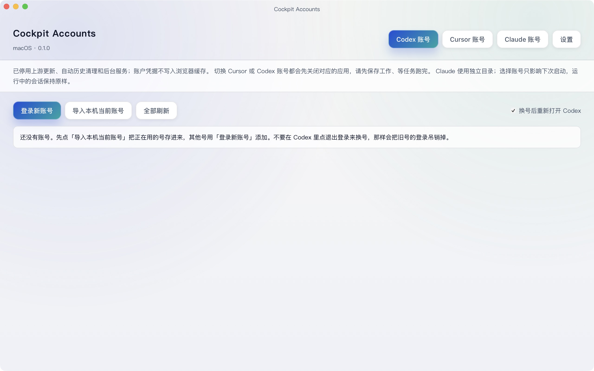

# Cockpit Accounts

macOS 上的 Codex、Cursor、Claude 账号管理器。分别登录自己的账号后，在同一个窗口里选择账号并切换或启动对应客户端。

这是 [Cockpit Tools](https://github.com/jlcodes99/cockpit-tools) 的精简衍生版，保留 **CC BY-NC-SA 4.0（非商业）**。非 OpenAI、Cursor 或 Anthropic 官方产品。署名和修改说明见 [NOTICE](NOTICE.md)。



## 安装

### Apple Silicon：下载应用

从 [Releases](https://github.com/Ayanami0730/cockpit-accounts/releases) 下载 `Cockpit-Accounts-0.1.0-macos-arm64.zip`，解压后拖到 Applications。也可在终端下载并检查安装脚本后执行：

```bash
curl -fL https://raw.githubusercontent.com/Ayanami0730/cockpit-accounts/v0.1.0/scripts/install-release.sh -o /tmp/install-cockpit-accounts.sh
less /tmp/install-cockpit-accounts.sh
bash /tmp/install-cockpit-accounts.sh
```

脚本安装到 `~/Applications`，不需要 sudo，不自动启动应用或导入账号。已有同名应用时会停止，先退出并移走旧副本再升级。应用为 ad-hoc 签名，尚无 Apple Developer ID 公证；macOS 拦截时，在系统设置 → 隐私与安全性中检查并选择“仍要打开”。安装脚本不会关闭 Gatekeeper。

要求 macOS 12 或更新版本。预编译包为 Apple Silicon；Intel 可尝试源码构建，但尚未在 Intel 硬件验收。使用 Claude 功能需要 Python 3（Apple Command Line Tools 提供）和已安装的官方 Claude Code CLI；Claude Desktop 功能还需要 `/Applications/Claude.app` 或 `~/Applications/Claude.app`。Claude 客户端自身的系统版本要求以其官方安装文档为准。

### 从源码构建和安装

先安装 Apple Command Line Tools、Node.js 22+、Python 3 和 Rust/rustup。已有 Homebrew 时可使用：

```bash
xcode-select --install
brew install node python rustup
```

如 Homebrew 提示给 rustup 添加 PATH，先按提示操作。随后：

```bash
git clone https://github.com/Ayanami0730/cockpit-accounts.git
cd cockpit-accounts
bash scripts/install-macos.sh
```

脚本安装项目锁定的依赖和 Rust 1.95.0，构建并复制应用到 `~/Applications`。首次构建会下载依赖并耗时数分钟以上。只想构建、不安装：

```bash
npm ci --ignore-scripts --no-audit --no-fund
rustup toolchain install 1.95.0 --profile minimal
python3 scripts/build-local-safe.py build
```

签名压缩包：`target/release/bundle/Cockpit-Accounts-0.1.0-macos-<架构>.zip`。打包在系统临时目录内签名，避免 iCloud 同步目录添加 Finder 属性导致签名失败；请使用压缩包中的应用。

## 添加与切换账号

**三个平台分别登录。登录 Codex 不会让 Cursor 或 Claude 自动获得登录或订阅。** 工具保存各平台自己的账号或独立配置，之后由你点击切换；不自动注册账号、购买订阅或根据额度循环切号。

| 平台 | 第一次添加 | 后续使用 |
| --- | --- | --- |
| Codex | 打开 Codex 账号页，点“登录新账号”，在浏览器完成官方登录；也可显式导入本机当前账号 | 点目标账号的切换按钮，确认后正常退出 Codex、写入认证，再按选项重开 |
| Cursor | 打开 Cursor 账号页，点添加账号，选择授权登录并完成浏览器登录；也可导入本机账号 | 点切换，应用会关闭并重新启动 Cursor，请先保存工作 |
| Claude | 新建独立配置，使用登录按钮打开官方 CLI 登录；Desktop 需要自己的官方登录 | 选择配置后启动 CLI 或 Desktop；Desktop 切换有空闲、会话备份和确认检查 |

Codex 浏览器若已登录其他账号，可复制授权链接到无痕窗口登录目标账号。认证完成后先回到管理器确认账号列表，再点击切换。Codex 的命令行或编辑器扩展可能仍持有旧认证，需要自行重启；管理器不会强杀它们。官方认证行为见 [Codex authentication](https://developers.openai.com/codex/auth)。

可以显式关联标准 `~/.claude`，保留现有 CLI 身份；该关联也使用管理器新建的独立 Desktop 目录，不导入系统 Desktop 的账号。Claude 的“设为默认”只影响从本工具发起的后续启动，不会改写你的 shell 别名或正在运行的会话。切换不会迁移云端聊天或运行中任务的内存。用量、积分或登录状态取不到时显示未知；旧快照不是当前可用性保证。

## 数据与隐私

本仓库及安装包不附带账号、令牌、Cookie、聊天记录、私人代理配置或原始 Git 历史。首次启动为空；导入和登录由使用者主动操作。

- 管理器数据在 `~/.cockpit_accounts`，与上游 Cockpit 和本地定制版本隔离。
- Codex/Cursor 的管理器凭据使用加密存储，macOS 密钥保存在 Keychain。官方客户端仍按自己的方式存储认证。
- Claude 新建账号的认证由官方客户端管理；显式关联的标准 CLI 配置保持原位，管理器不复制其认证。管理器保存标签、使用量摘要和会话保护记录。备份可能包含你的会话内容，请按私人数据保管。
- 没有个人 SSH 同步、固定 VPS、遥测上传、自动上游更新、后台监听服务或自动历史清理。登录与用量查询仍需连接对应平台。
- 导出账号文件可能包含凭据。不要上传数据目录、导出文件、截图或未检查的日志到 GitHub issue。

卸载应用不会删除账号数据或官方客户端的认证。升级前自行保护数据；不要从不可信来源导入账号文件。

## 开发与验证

```bash
npm run typecheck
npm test
python3 -B scripts/test_claude_local_safe_runner.py
python3 -B scripts/test_claude_session_vault.py
python3 -B scripts/test_claude_local_companion.py
python3 -B scripts/test_claude_switch.py
python3 scripts/privacy-check.py
```

本版本的具体测试记录和兼容性边界见 [验证记录](docs/VALIDATION.md)。单元测试使用合成账号与临时目录，不能代替各平台真实账号的登录验收。客户端更新可能改变认证格式或切换行为。
